<div align="right">
  <a href="./README.md">简体中文</a> | <strong>English</strong>
</div>

<div align="center">
  
  <h1>SkillHub</h1>
  <p><strong>A Cross-Platform Desktop Hub to Discover, Organize & Sync AI Skills and Prompts</strong></p>
  <p>Discover open-source skills and prompts, preview and translate them before installing, organize with a file-manager feel, and sync to your AI agents in one click.</p>
  <p>
    
    
    
    
  </p>
</div>

<p align="center">
  <a href="#why-skillhub">Why SkillHub</a> ·
  <a href="#screenshots">Screenshots</a> ·
  <a href="#features">Features</a> ·
  <a href="#download">Download</a> ·
  <a href="#development">Development</a> ·
  <a href="#community">Community</a> ·
  <a href="#buy-me-a-coffee">Buy Me a Coffee</a>
</p>

## Why SkillHub

When working regularly with AI tools like Claude Code, Cursor, Windsurf, Antigravity, or Codex, managing skills and prompt templates quickly runs into the same friction points:

- **Hard to discover and tedious to install**: Great open-source skills and prompts are scattered across GitHub repos, leaderboards, and communities—often forcing you to clone an entire monorepo just to copy one subfolder.
- **Scattered everywhere and out of date**: Some live in local folders, some were cloned from GitHub, and others are buried in notes or bookmarks. Running `git pull` one by one gets old fast.
- **Long docs are hard to scan**: Many open-source skills are lengthy `SKILL.md` files without a table of contents or bilingual reading support.
- **High friction across AI tools**: Sharing the same skill setup across multiple AI agents usually means manually copying folders or constantly switching windows to copy prompts.

**SkillHub brings the entire workflow—Discover → Preview & Translate → Precision Install → File-Manager Organization → Agent Sync → Tray Quick Access—into one lightweight native desktop app**, backed by local-first SQLite storage and multi-channel network resilience.

---

## Screenshots

> Screenshots below were captured on macOS; Windows and Linux share the same layout and interactions.

### Part 1: Resource Discovery & One-Click Install

#### 1. All-New Resource Hub: Discover & Skill Leaderboards

Explore and install open-source skills directly inside SkillHub without leaving the app:

- **Discover**: Curated thematic skill packs, daily trending Top 8, and quick access to your subscribed repositories.
- **Daily Live Leaderboards**: Automatically synced across 6 live dimensions (Best Overall, Rising This Week, Most Installed, Newly Rising, Official Picks, Community Buzz) with category filters, highlighted search, and an uninstalled-only toggle.
- **Curated Collections**: Hand-picked skill collections for dev workflows, e-commerce growth, PPT/office automation, and more—complete with one-click batch installation for missing skills and 24-hour remote hot-updates.


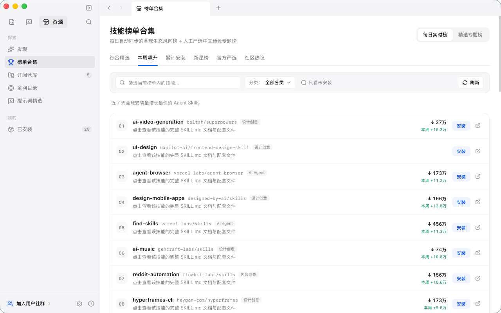

#### 2. Subscribed Git Repos, Global Directory & Pre-Install `SKILL.md` Preview

- **Custom Repo Subscriptions**: Subscribe to public or private Git repositories like package feeds (with multi-host GitHub/GitLab read-only token support and incremental sync) and extract individual sub-skills on demand.
- **Global Skill Directory**: Switch seamlessly between the `skills.sh` global install-count directory and live GitHub repository search.
- **Live Preview & Precision Install**: Click any remote skill to inspect its full `SKILL.md`, translate the summary, and browse bundled files before installing. Multi-skill monorepos extract only the selected sub-skill (or the full package on demand), while standalone repos clone cleanly as Git repos—all tracked together under **Installed** for one-click updates.

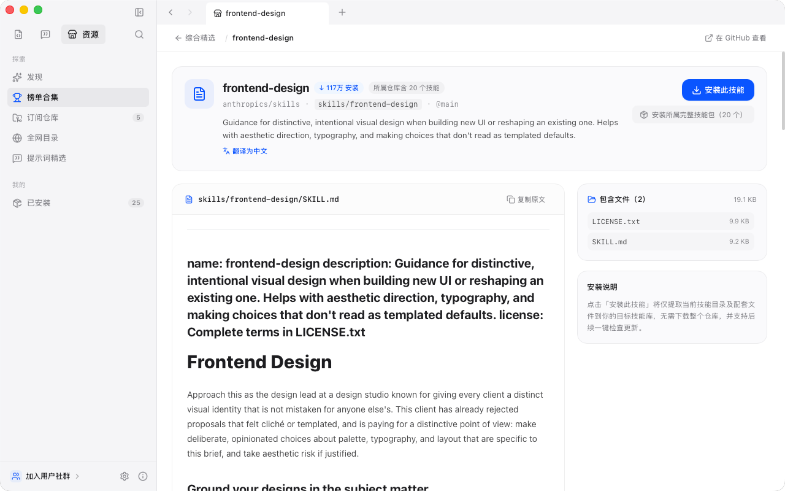

#### 3. Multi-Source Open Prompt Catalog & Local Prompt Library

Go beyond static prompt lists with 4 live open-source prompt ecosystems integrated directly under **Explore → Prompt Catalog**:

- **Four Open Channels**: **AiShort** (bilingual EN/ZH prompts with usage notes), **prompts.chat** (3,000+ community prompts with API-first search and mirror CSV fallback), **Fabric** (266 engineering system patterns loaded on demand), and **LangGPT** (structured prompt templates).
- **Full-Width Preview & One-Click Save**: Switch between languages, auto-chunked Chinese translation, rendered/raw views, and detected `{{variables}}`—then save straight into your local prompt library with synced installed state.
- **Local Prompt Management**: Organize by workflow groups, custom sorting, tags, and stars. Toggle between **Formatted View** and **Plain Text View** while editing structured prompts, and export as Markdown, JSON, or plain text.

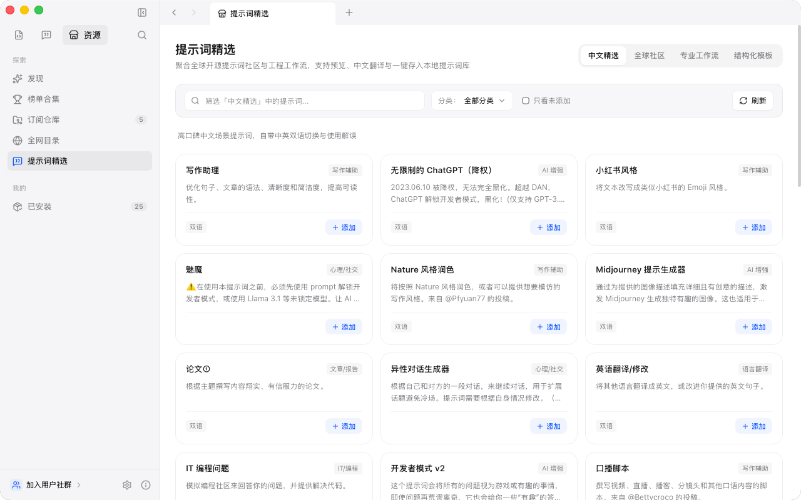

<table>
  <tr>
    <td width="50%"></td>
    <td width="50%">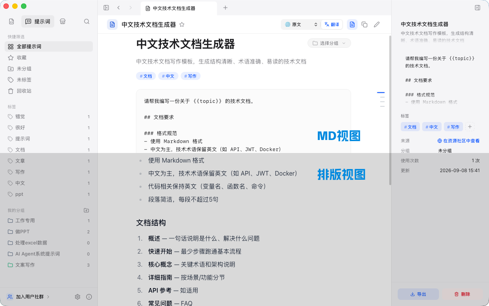</td>
  </tr>
</table>

---

### Part 2: File-Manager Feel & Long-Doc Reading

#### 4. Multi-Tab Workspace & Layered Skill Overview

Work across browser-style tabs (`Cmd/Ctrl + T` to open, `Cmd/Ctrl + W` to close, back/forward history, and automatic session restore)—keep your Skill Library, a Skill Package interior, the Resource Hub, and Prompts open side by side. SkillHub automatically separates multi-skill **Skill Packages** from standalone **Skills**, with category/grid views and one-click sub-skill expansion.

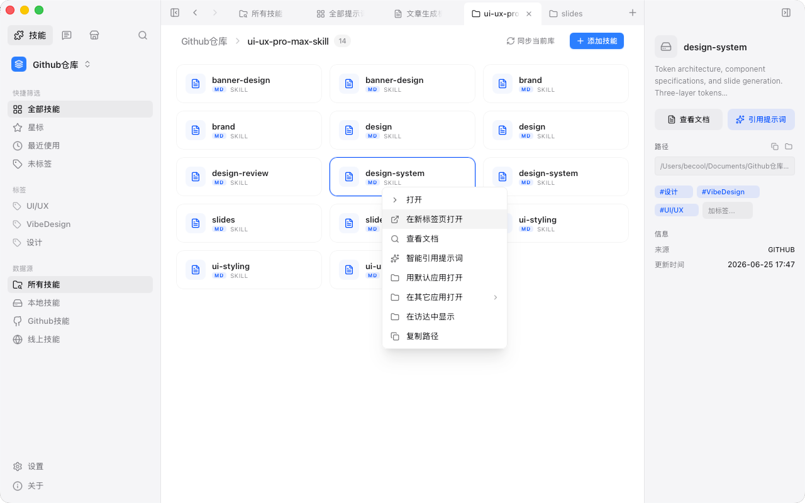

#### 5. Desktop File-Manager Interactions: Drag, Box-Select, Native Context Menus & Batch Actions

Every interaction is crafted to feel as natural as macOS Finder or Windows File Explorer:

- **Drag to Import & Organize**: Drag local skill folders straight onto the window to import; reorder and organize libraries and prompt groups via drag-and-drop in the sidebar.
- **Marquee Box Selection & Batch Actions**: Drag across empty canvas space to multi-select cards (`Shift` for range select, `Cmd/Ctrl` for toggle select), then batch star, tag, update, export as folder/ZIP, or delete.
- **Full Native Context Menus**: Right-click any card, skill package, or sidebar item to open, edit, rename, tag, sync to AI agents, pull updates, or reveal in Finder/Explorer.

<table>
  <tr>
    <td width="50%">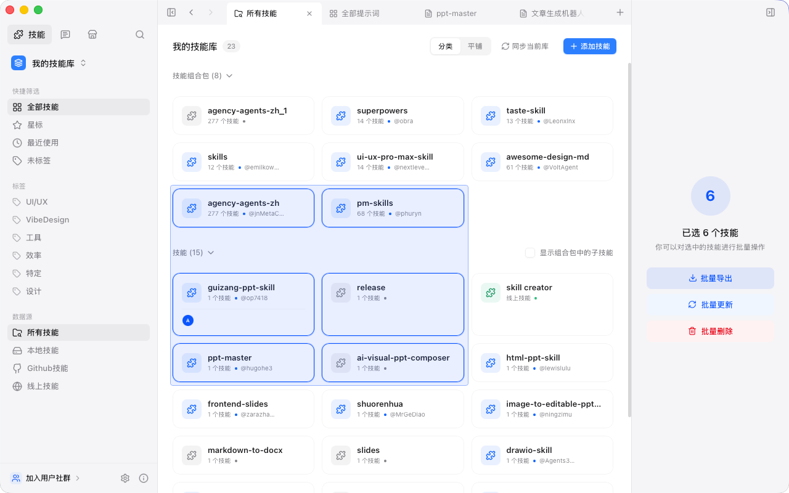</td>
    <td width="50%">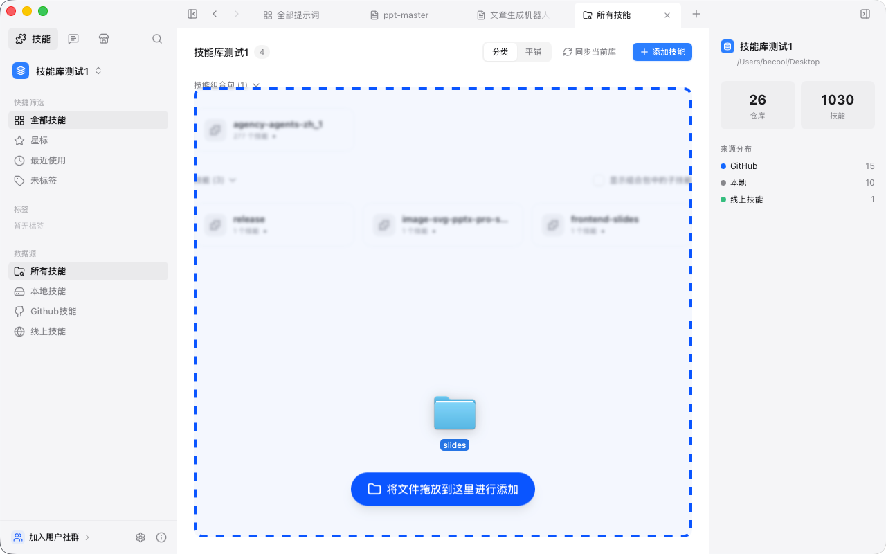</td>
  </tr>
</table>

#### 6. Two-Tier Stars, Dedicated Tag Manager & Custom Library Icons

Starring and tagging operate independently across two levels so **Skill Packages** and their **Sub-Skills** never clobber each other. A built-in **Tag Manager** lets you pin frequent tags, inspect usage counts, rename/merge tags, and prune unused ones—paired with multiple mountable local libraries and custom folder icons.


#### 7. Multi-Source Imports, Async Clone Progress & One-Click Updates

Beyond installing from the Resource Hub, you can link existing local folders, clone any GitHub repo (automatically stripping `git clone` prefixes and web URL paths), or bookmark online links. Clones and pulls run asynchronously with live progress cards and expandable streaming logs, and Git-backed repos support one-click upstream checks and updates.

<table>
  <tr>
    <td width="50%">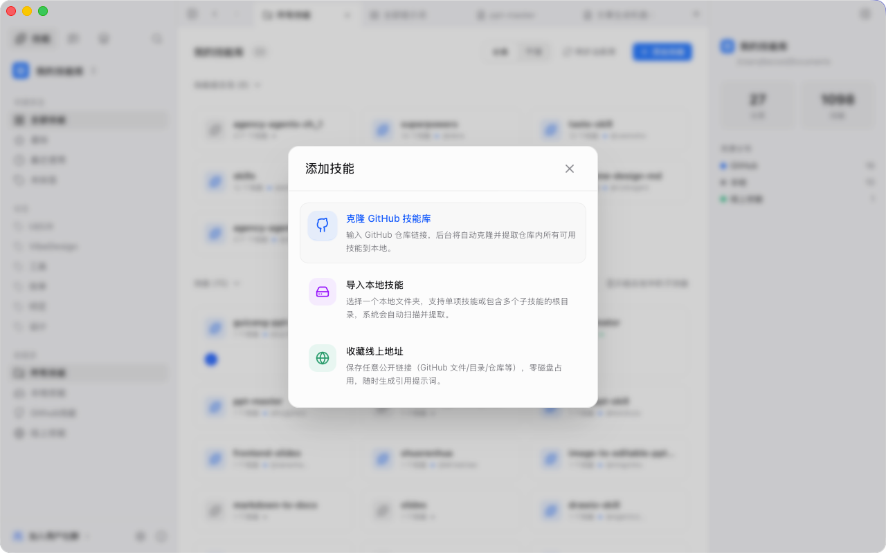</td>
    <td width="50%">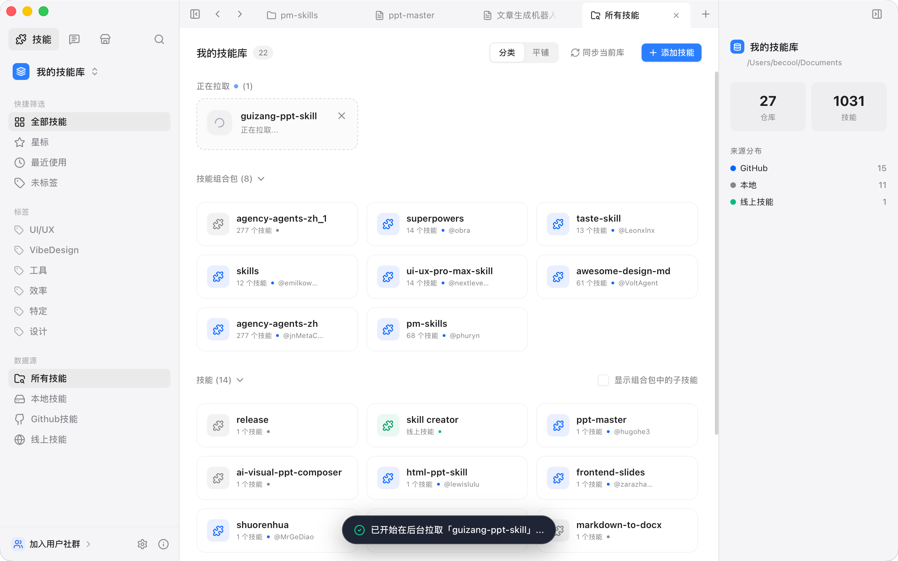</td>
  </tr>
</table>

#### 8. Spacebar Quick Look

Just want to check what a skill or prompt does without navigating away? Select any card and press **Spacebar** for a translucent Markdown preview overlay, then press Spacebar or `Esc` to dismiss.

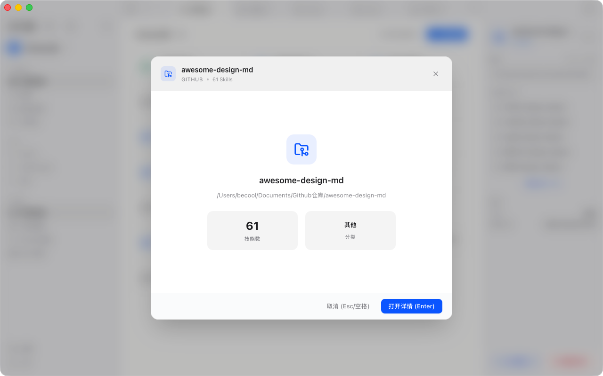

#### 9. Document Outline (TOC) & Tri-Engine Translation

Long `SKILL.md` guides automatically get a right-hand table of contents that tracks your scroll position and jumps smoothly to any section. Toggle translation to read English docs in Chinese with original side-by-side comparison, powered by a self-healing 3-engine fallback pipeline (Google → Tencent TranSmart → MyMemory).

<table>
  <tr>
    <td width="50%">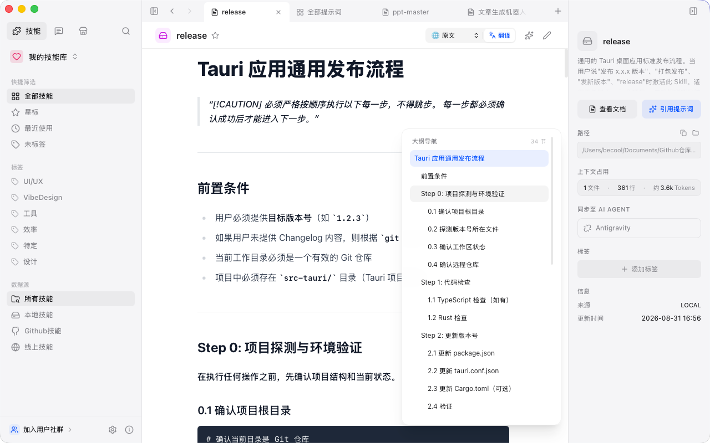</td>
    <td width="50%">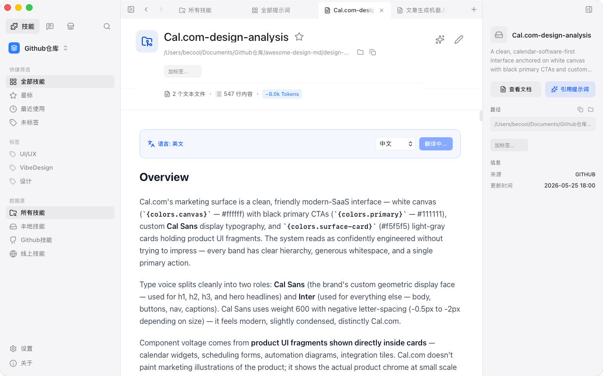</td>
  </tr>
</table>

---

### Part 3: Multi-Agent Sync, Instant Access & Local-First Safety

#### 10. Symlink Agent Sync & Structured Reference Prompts

- **Real-Time Symlink Mounting**: One-click presets for Cursor, Claude Code, Windsurf, Antigravity, Codex, and more—sync or unsync via the context menu or inspector without duplicating files.
- **Smart Reference Prompt Builder**: Generate a ready-to-paste instruction block containing the skill's file structure and execution rules so any AI chat follows it faithfully.

<table>
  <tr>
    <td width="50%">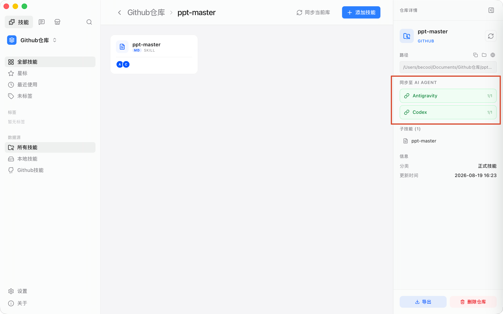</td>
    <td width="50%"></td>
  </tr>
</table>

#### 11. Menu Bar / System Tray Quick Panel & `Cmd/Ctrl + K` Global Search

- **Floating Tray Launcher**: Click the macOS menu bar or Windows system tray icon to fuzzy-search your active library's packages, skills, and prompts, copy `@skill-name` references or prompt content in one click, and auto-dismiss when returning to your editor.
- **Cross-Source Global Search**: Press `Cmd/Ctrl + K` to search local libraries, prompts, curated collections, subscribed repos, and GitHub repositories. Add a read-only personal GitHub Token (no scopes required) via the search modal or settings to unlock GitHub's 5,000 req/hr quota.


<table>
  <tr>
    <td width="50%">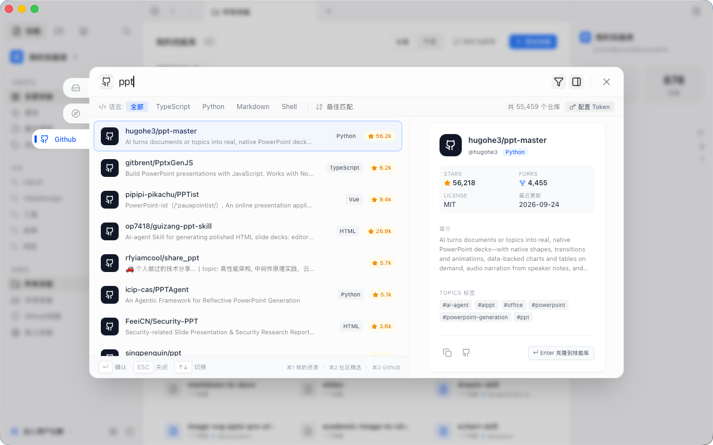</td>
    <td width="50%">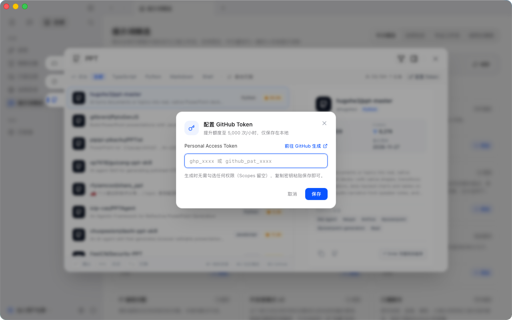</td>
  </tr>
</table>

#### 12. Local-First SQLite, ZIP Backups & Network Resilience

- **Local Storage & Safe Migration**: All indexes, prompts, and settings stay local in SQLite. Export a full ZIP backup anytime and restore on another machine—SkillHub automatically snapshots your current state before importing.
- **Resilient Connectivity & Quiet Background**: Git clones, leaderboards, prompt feeds, and in-app updates automatically fall back across system proxy, direct connection, and mirrors. Launch at login silently to the tray, with background auto-sync turned off by default to avoid unwanted proxy/VPN traffic.

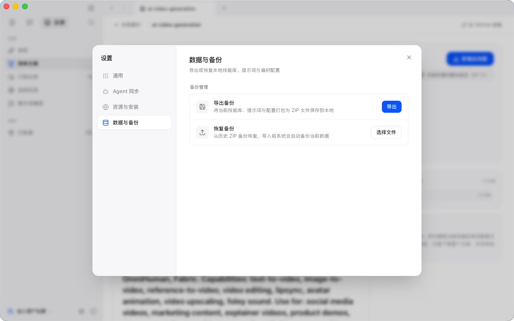

---

## Features

| Category | Feature | Details |
| :--- | :--- | :--- |
| **Resource Hub** | Discover / Leaderboards / Repos / Directory | 6 daily live leaderboards, hot-updatable curated packs, custom Git repo subscriptions, `skills.sh` + GitHub search |
| **Precision Install** | `SKILL.md` preview & unified updates | Live preview and translation before install; sub-skill extraction and standalone Git clones managed together under Installed |
| **Prompt Catalog** | 4 open-source prompt ecosystems | AiShort, prompts.chat, Fabric, and LangGPT with bilingual views, chunked translation, variable detection, and one-click save |
| **Desktop UX** | File-manager interactions | Drag-and-drop import & grouping, marquee multi-select batch actions, native context menus, Spacebar Quick Look, and multi-tabs |
| **Two-Tier Org** | Independent stars & Tag Manager | Separate stars and tags for packages, sub-skills, and prompts; pin frequent tags, inspect counts, rename, merge, and clean up |
| **Multi-Source** | Local / GitHub / Online links | Link local folders, drag-and-drop imports, async Git clones with streaming logs, or bookmark web URLs |
| **Long Docs** | Outline TOC & 3-engine translation | Auto-generated heading TOC with scroll spy; self-healing translation with bilingual toggle |
| **Prompt Library** | Workflow groups & dual-view editor | Group by workflow, tag autocomplete, formatted/raw view switch, and Markdown / JSON / TXT export |
| **Agent Sync** | Symlink mounting & reference builder | Presets for major AI coding tools with real-time symlink sync and structured reference prompt generation |
| **Quick Access** | Tray panel & `Cmd/Ctrl + K` | Instant search & copy from the system tray; cross-source global search with optional read-only GitHub PAT |
| **Local & Safe** | SQLite, ZIP backup & traffic control | Local-first storage with pre-restore snapshots, mirror fallback, silent auto-start, and opt-in background sync |

---

## Download

Get the latest installer for your OS from the [Releases page](https://github.com/VipBeCool/SkillHub/releases/latest):

| Platform | Installer Format |
| :--- | :--- |
| **macOS** (Intel & Apple Silicon) | `.dmg` (Universal Binary) |
| **Windows** (64-bit) | `.exe` Installer / `.msi` |
| **Linux** (64-bit) | `.AppImage` / `.deb` |

> SkillHub supports automatic update checks, structured changelog preview, and one-click in-app updates.

---

## Tech Stack

| Layer | Technology |
| :--- | :--- |
| **Frontend** | React 19, TypeScript, Tailwind CSS v4, Vite |
| **Desktop & Storage** | Rust, Tauri v2, SQLite (`rusqlite`) |
| **CI/CD** | GitHub Actions + `tauri-action` |

Built with Tauri v2 and the native system WebView instead of Electron—keeping installer sizes compact and background memory usage minimal.

---

## Development

### Prerequisites

- [Node.js](https://nodejs.org/) v18 or later
- [Rust](https://www.rust-lang.org/tools/install) stable toolchain
- macOS: Xcode Command Line Tools (`xcode-select --install`)
- Windows: Visual Studio C++ Build Tools

### Run Locally

```bash
# 1. Clone the repository
git clone https://github.com/VipBeCool/SkillHub.git
cd SkillHub

# 2. Install dependencies
npm install

# 3. Start dev mode
npm run skillhub dev
```

### Build

```bash
npm run skillhub build
```

Built installers are placed under `src-tauri/target/release/bundle/`.

---

## Open-Source Credits

SkillHub's Resource Hub and Prompt Catalog integrate data from these outstanding open-source projects:

- [Linkly AI · Best Skills](https://github.com/LinklyAI/best-skills) (CC BY 4.0) — Daily live skill leaderboards
- [skills.sh](https://skills.sh) — Global public Agent Skills directory and install metrics
- [AiShort (ChatGPT-Shortcut)](https://github.com/rockbenben/ChatGPT-Shortcut) (MIT) — Bilingual curated prompt library
- [prompts.chat](https://prompts.chat) (CC0) — Global open-source prompt community & dataset
- [Fabric](https://github.com/danielmiessler/fabric) (MIT) — Engineering system prompt patterns
- [LangGPT](https://github.com/langgptai/LangGPT) (Apache-2.0) — Structured prompt template system

---

## Community

If you run into bugs or have feature ideas, feel free to open an Issue or join our community channels:

<table>
  <tr>
    <th align="center">QQ Group (1049282993)</th>
    <th align="center">WeChat Official Account</th>
  </tr>
  <tr>
    <td align="center"></td>
    <td align="center"></td>
  </tr>
</table>

---

## Buy Me a Coffee

If SkillHub saves you time in your daily AI workflow, feel free to [buy me a coffee](./docs/DONATE.md). Thanks for the support!

---

## License

Open-sourced under the [GPL-3.0 License](./LICENSE). You are free to use, study, and modify the source code, provided derivative works remain open-source under the same license. For commercial closed-source licensing, please contact the author in advance.

---

By [VipBeCool](https://github.com/VipBeCool)
