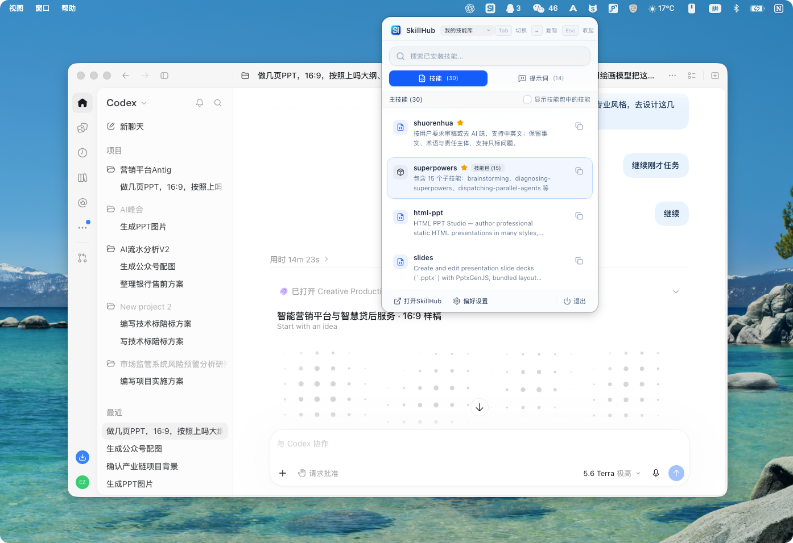
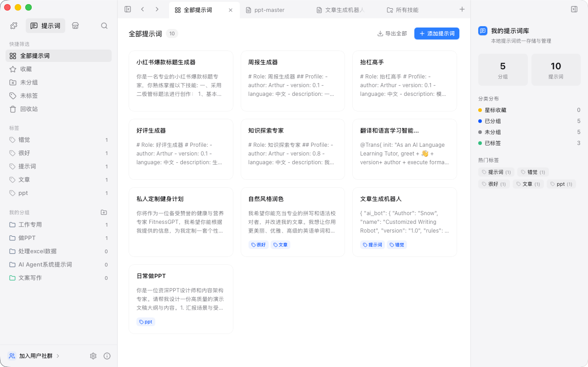
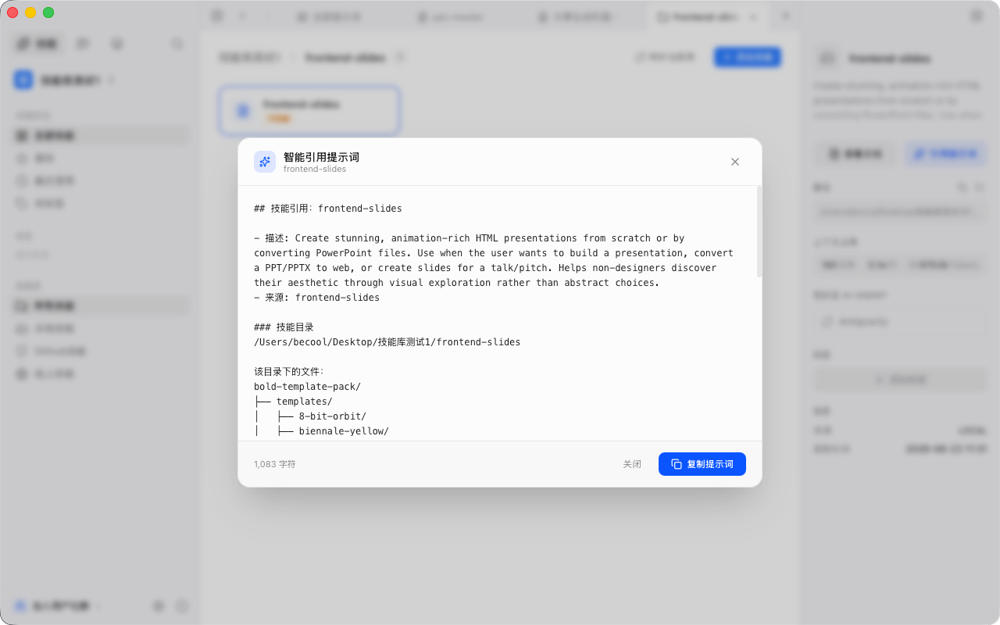
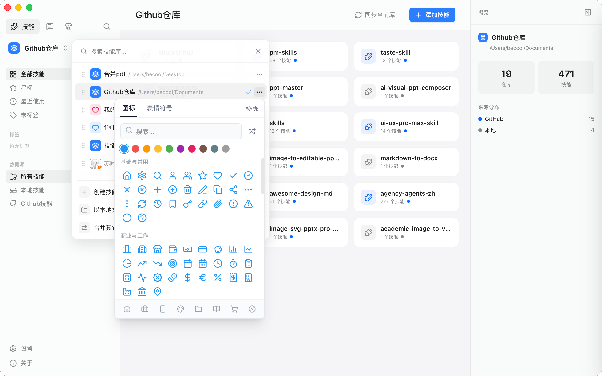

<div align="right">
  <a href="./README.md">简体中文</a> | <strong>English</strong>
</div>

<div align="center">
  
  <h1>SkillHub</h1>
  <p><strong>A Cross-Platform Desktop Manager for AI Skills & Prompts</strong></p>
  <p>Keep local folders, GitHub skill packages, online links, and prompt templates in one place—easy to search, read, and sync to your AI tools.</p>
  <p>
    
    
    
    
  </p>
</div>

<p align="center">
  <a href="#why-skillhub">Why SkillHub</a> ·
  <a href="#screenshots">Screenshots</a> ·
  <a href="#features">Features</a> ·
  <a href="#download">Download</a> ·
  <a href="#development">Development</a> ·
  <a href="#community">Community</a> ·
  <a href="#buy-me-a-coffee">Buy Me a Coffee</a>
</p>

## Why SkillHub

When working regularly with AI tools like Claude Code, Cursor, Antigravity, or Codex, you quickly build up a pile of skill folders, multi-skill packages, and recurring prompt templates. After a while, managing them gets messy:

- **Scattered everywhere**: Some live in random local folders, some were cloned from GitHub, and others are buried in notes or browser bookmarks.
- **Hard to keep up to date**: Open-source skill repos get updated upstream, and running `git pull` one by one is tedious.
- **Tough to browse long docs**: Many open-source skills are long `SKILL.md` files without a table of contents—or written in a language you prefer to read with translation alongside.
- **Awkward to reuse across tools**: Sharing the same skill setup across different AI agents usually means manually copying folders or rewriting prompt context.

**SkillHub is built to keep that clutter organized**: bring local directories, GitHub repositories, and web links into one native desktop app where you can search fast, preview with Spacebar, organize with tags and stars, and sync directly to your AI agents.

---

## Screenshots

> Screenshots below were captured on macOS; Windows and Linux share the same workflow and layout.

### 1. Menu Bar / System Tray Quick Panel

Open a lightweight floating panel from the macOS menu bar or Windows system tray without switching back to the main window. Fuzzy-search your active workspace's skill packages, skills, and prompts, copy `@skill-name` references or prompt text in one click, and dismiss it automatically when you switch back.



### 2. Global Search & Direct GitHub Search

Press `Cmd/Ctrl + K` to open Global Search. Alongside searching local skill packages, skills, and prompts, you can switch to the **GitHub** scope to search open-source skill repositories online and clone them straight into your library.


Unauthenticated GitHub searches are rate-limited to 10 requests/minute. Add a read-only personal GitHub Token in settings (no extra permissions needed) to unlock GitHub's 5,000 requests/hour quota.


### 3. Multi-Tab Workspace & Layered Overview

Work across browser-style tabs—keep "All Skills", a specific skill package, or your prompt library open at once. SkillHub automatically distinguishes multi-skill **Skill Packages** from standalone **Skills**, supports categorized and grid views, and lets you expand sub-skills when needed.


### 4. Spacebar Quick Look

Don't want to open a full detail view just to check what a skill does? Select any card and press **Spacebar** for a quick Markdown preview, then press Spacebar or `Esc` to close it.


### 5. Dedicated Prompt Manager & Dual-View Editor

Prompts have their own workspace with workflow groups, custom sorting, tags, and stars. When editing or reviewing structured Markdown prompts, switch between **Formatted View** and **Plain Text View** to preserve exact line breaks and indentation.

<table>
  <tr>
    <td width="50%"></td>
    <td width="50%"></td>
  </tr>
</table>

### 6. Document Outline (TOC) & Translation

Longer skill guides get an automatic right-hand table of contents that tracks your scroll position and jumps to any heading in one click. For foreign-language skills, toggle translation to read Chinese/bilingual content side by side.

<table>
  <tr>
    <td width="50%"></td>
    <td width="50%"></td>
  </tr>
</table>

### 7. Sync Skills to AI Agents

Sync local skills straight into your AI agent directories (such as Antigravity, Claude Code, Cursor, Codex, and more) from the right-click menu or inspector panel. Synced targets appear directly on each card.


### 8. Reference Prompt Generator

Need an agent to follow a skill's rules reliably? Generate a structured reference prompt containing the skill's directory layout and instructions, ready to copy and paste into any chat.



### 9. Flexible Imports & Batch Updates

Link existing local folders, drag and drop directories onto the window, clone GitHub repositories, or bookmark online skill URLs. GitHub-backed repos can be checked and updated in one click.

<table>
  <tr>
    <td width="50%"></td>
    <td width="50%"></td>
  </tr>
</table>

### 10. Tags, Stars & Batch Operations

Drag-select multiple cards like in a desktop file manager to batch update, delete, or export (skills export as folders or ZIP archives; prompts export as Markdown, JSON, or plain text).  
Tagging and starring work cleanly across two levels: **Skill Packages** and individual **Sub-Skills** can be starred and tagged independently without clobbering each other, backed by a dedicated **Tag Manager** for pinning common tags, renaming, merging, and pruning unused tags.

<table>
  <tr>
    <td width="50%"></td>
    <td width="50%"></td>
  </tr>
</table>

### 11. Local-First Storage & Backup Restore

Your libraries, prompts, and settings stay local in SQLite. Export a full ZIP backup from settings anytime, and restore it on a new machine—SkillHub automatically snapshots your current state beforehand.


---

## Features

| Category | Feature | Details |
| :--- | :--- | :--- |
| **Tray Quick Panel** | Menu bar / system tray launcher | Search the active workspace and copy skill references or prompts without opening the main window |
| **Global Search** | `Cmd/Ctrl + K` across sources | Search local libraries, community collections, and live GitHub repositories |
| **GitHub Token** | Read-only PAT support | Boosts GitHub search rate limit to 5,000 req/hr with easy editing or removal |
| **Multi-Source** | Local / GitHub / Online links | Mount local folders, drag-and-drop imports, clone Git repos, or bookmark web skills |
| **Tagging** | Two-tier tags & Tag Manager | Independent tags for packages, sub-skills, and prompts; pin common tags, rename, merge, or clean up |
| **Starring** | Independent package & skill stars | Star a skill package without starring all sub-skills inside it; filtered cleanly in Starred view |
| **Workspace** | Browser-style tabs | Keep multiple views, package contents, and skill docs open side by side |
| **Quick Look** | Spacebar preview | Press Spacebar on any selected card to peek at its Markdown doc right away |
| **Reading** | Outline TOC & translation | Auto-generated heading navigation and one-click translation with original comparison |
| **Agent Sync** | Sync to AI tools | Install or unsync skills to Antigravity, Claude Code, Cursor, Codex, etc. |
| **Prompts** | Groups & dual-view editor | Group by workflow, autocomplete tags, toggle rendered/raw view, export MD/JSON/TXT |
| **References** | Reference prompt builder | Generates copy-ready instruction prompts with file structure and context |
| **Batch Actions** | Box select & context menu | Multi-select cards to batch star, tag, update, export (folder/ZIP), or delete |
| **Backup** | Local SQLite & ZIP export | Offline-first storage with full-library export and pre-restore safety snapshots |

---

## Download

Get the latest installer for your OS from the [Releases page](https://github.com/VipBeCool/SkillHub/releases/latest):

| Platform | Installer Format |
| :--- | :--- |
| **macOS** (Intel & Apple Silicon) | `.dmg` (Universal Binary) |
| **Windows** (64-bit) | `.exe` Installer / `.msi` |
| **Linux** (64-bit) | `.AppImage` / `.deb` |

> SkillHub checks for new releases and supports in-app updates.

---

## Tech Stack

| Layer | Technology |
| :--- | :--- |
| **Frontend** | React 19, TypeScript, Tailwind CSS v4, Vite |
| **Desktop & Storage** | Rust, Tauri v2, SQLite (rusqlite) |
| **CI/CD** | GitHub Actions + tauri-action |

Built with Tauri v2 instead of Electron, keeping installer sizes small and background memory usage low.

---

## Development

### Prerequisites

- [Node.js](https://nodejs.org/) v18 or later
- [Rust](https://www.rust-lang.org/tools/install) stable toolchain
- macOS: Xcode Command Line Tools (`xcode-select --install`)
- Windows: Visual Studio C++ Build Tools

### Run Locally

```bash
# 1. Clone the repository
git clone https://github.com/VipBeCool/SkillHub.git
cd SkillHub

# 2. Install dependencies
npm install

# 3. Start dev mode
npm run skillhub dev
```

### Build

```bash
npm run skillhub build
```

Built installers are placed under `src-tauri/target/release/bundle/`.

---

## Community

If you run into bugs or have feature ideas, feel free to open an Issue or join the community channels:

<table>
  <tr>
    <th align="center">QQ Group (1049282993)</th>
    <th align="center">WeChat Official Account</th>
  </tr>
  <tr>
    <td align="center"></td>
    <td align="center"></td>
  </tr>
</table>

---

## Buy Me a Coffee

If SkillHub saves you time in your daily AI workflow, feel free to [buy me a coffee](./docs/DONATE.md). Thanks for the support!

---

## License

Open-sourced under the [GPL-3.0 License](./LICENSE). You are free to use, study, and modify the source code, provided derivative works remain open-source under the same license. For commercial closed-source licensing, please contact the author in advance.

---

By [VipBeCool](https://github.com/VipBeCool)
