<div align="right">
  <strong>简体中文</strong> | <a href="./README.en.md">English</a>
</div>

<div align="center">
  
  <h1>SkillHub</h1>
  <p><strong>跨平台的 AI 技能与提示词桌面管理工具</strong></p>
  <p>把分散在本地、GitHub 和书签里的 Skill、技能包与 Prompt 收纳到一起，方便查找、阅读和同步到常用 AI 工具。</p>
  <p>
    
    
    
    
  </p>
</div>

<p align="center">
  <a href="#为什么做这个">为什么做这个</a> ·
  <a href="#界面与功能">界面与功能</a> ·
  <a href="#主要功能">主要功能</a> ·
  <a href="#下载安装">下载安装</a> ·
  <a href="#本地开发">本地开发</a> ·
  <a href="#交流群">交流群</a> ·
  <a href="#请我喝咖啡">请我喝咖啡</a>
</p>

## 为什么做这个

平时用 Claude Code、Cursor、Antigravity、Codex 这类 AI 工具写代码、做文档或跑工作流，时间一长，手里往往会攒下不少 Skill 文件夹、整套技能包和常用的 Prompt 模板。管理起来通常会碰到几件烦心事：

- **放得很散**：有的躺在本地临时目录里，有的刚从 GitHub 仓库拉下来，还有的记在备忘录或浏览器书签里，真要用的时候得四处翻；
- **更新不同步**：关注或克隆过的开源技能库上游更新了也不知道，手动一个个 `git pull` 很麻烦；
- **长文档难读**：不少开源 Skill 是很长的英文 `SKILL.md`，在编辑器里直接看既没有大纲跳转，读英文也费劲；
- **复用成本高**：想让不同的 Agent 共用同一批技能，总要手工复制目录或拼接提示词上下文。

**SkillHub 就是把这些零散事情理顺的桌面工具**：支持统一收纳本地文件夹、GitHub 仓库和线上技能链接，提供快速搜索、空格预览、标签/星标整理、中英翻译，并可直接同步到常用的 AI Agent 目录里。

---

## 界面与功能

> 以下截图均来自 macOS 端，Windows 与 Linux 端交互一致。

### 1. 菜单栏 / 系统托盘快捷面板

写代码或聊天时不想切回主窗口，点一下 macOS 顶部菜单栏或 Windows 系统托盘图标就能唤出悬浮面板。支持按当前工作区快速检索技能包、技能与提示词，一键复制 `@skill-name` 引用或提示词正文，切换到其他窗口时自动收起。

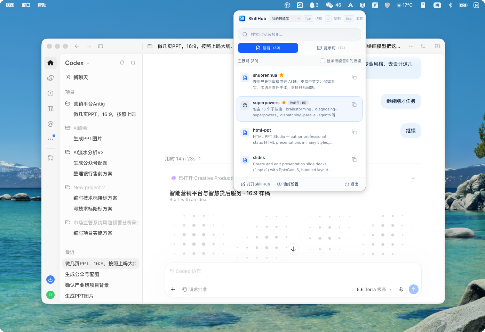

### 2. 全局搜索与 GitHub 在线检索

按下 `Cmd/Ctrl + K` 打开全局搜索，除了查找本地的技能包、技能与提示词，还可以切换到 **GitHub** 页签直接搜索开源仓库，选中后直接克隆到本地技能库。

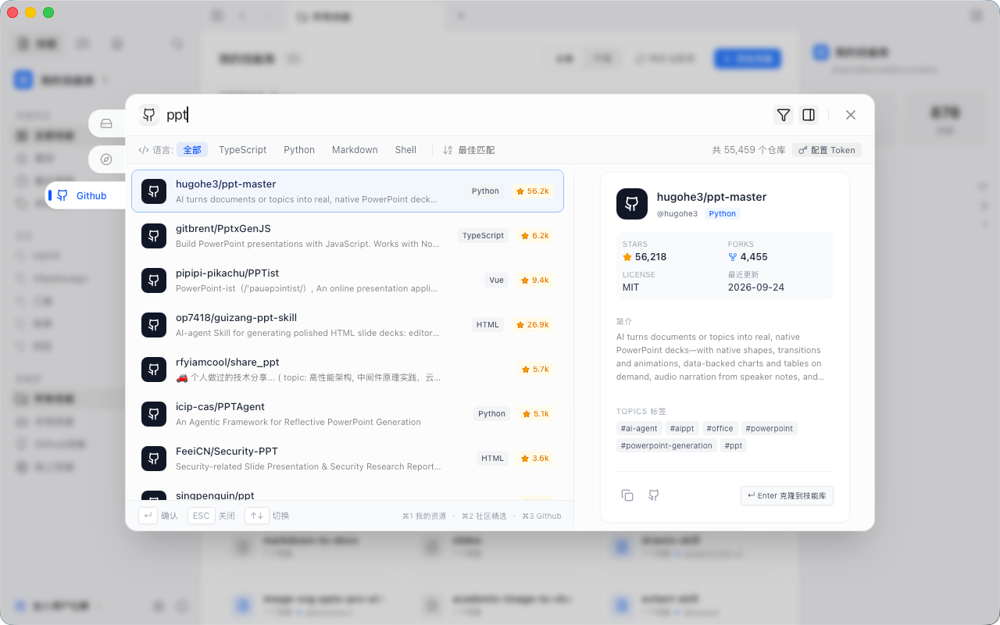

GitHub 对未登录搜索有每分钟 10 次的限制；在设置里填入一个只读的个人 GitHub Token（无需额外敏感权限），即可使用 5,000 次/小时的请求额度。


### 3. 多标签工作区与分层管理

顶部采用类似浏览器的多标签页，可以同时打开「所有技能」、某个「技能包」内部或「提示词」页面随时切换。主视图会自动区分包含多个子技能的**技能包**和独立**单技能**，支持分类视图与网格视图切换，也可以勾选展开技能包里的全部子技能。

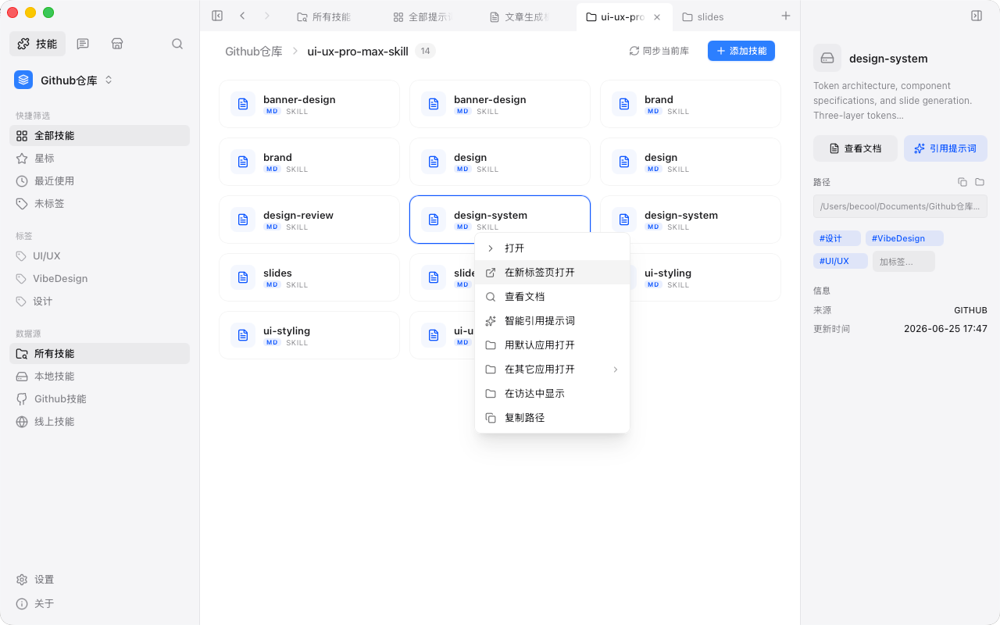

### 4. 空格键快速预览（QuickLook）

只是想确认一下某个技能干什么用，不必专门点进详情页再退出来。在列表里选中技能卡片，按一下**空格键**即可弹出浮层预览内容和 Markdown 文档，再按一次空格或 `Esc` 关闭。

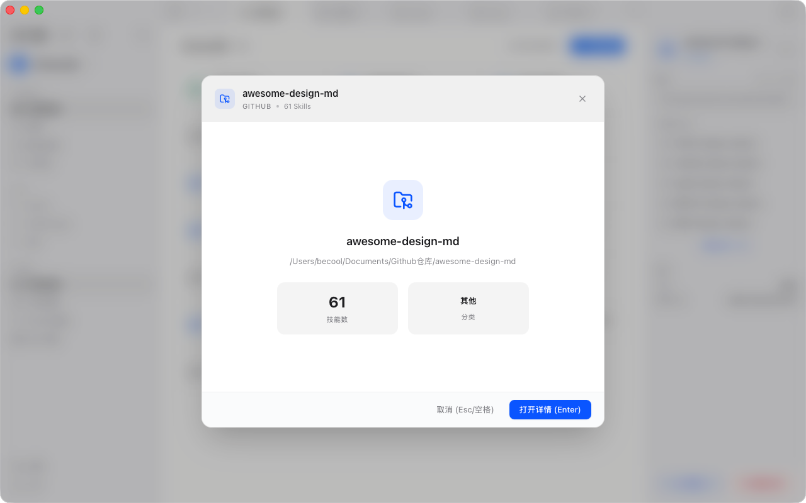

### 5. 提示词管理与双视图编辑

提示词模块独立管理日常常用的模板与指令，支持按工作流分组、自定义排序、标签筛选和常用星标。查看或修改格式较复杂的提示词时，可以在 **「排版视图」与「纯文本视图」** 之间切换，保留原始换行与缩进，改写参数更直观。

<table>
  <tr>
    <td width="50%">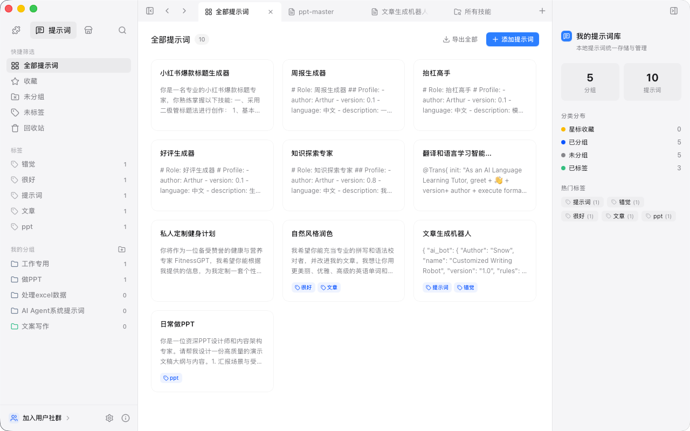</td>
    <td width="50%">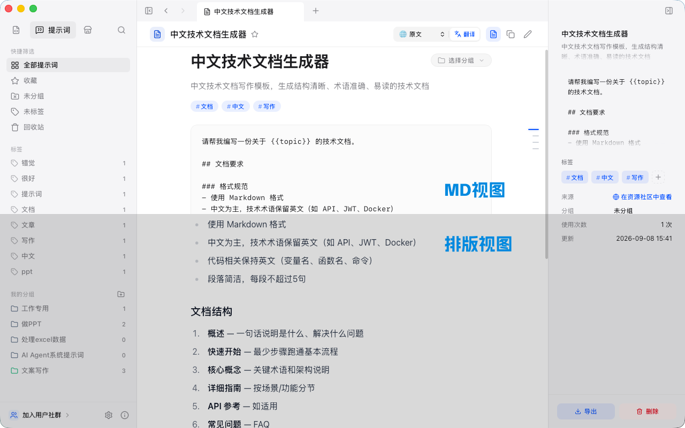</td>
  </tr>
</table>

### 6. 文档大纲导航与英文翻译

针对章节较多、规则较长的 Skill 文档，详情页右侧会自动提取标题层级生成大纲目录，随滚动高亮当前位置，点击即可跳到对应小节。阅读纯英文技能说明时，可以点击翻译切换为中文，并支持原文对照。

<table>
  <tr>
    <td width="50%"></td>
    <td width="50%">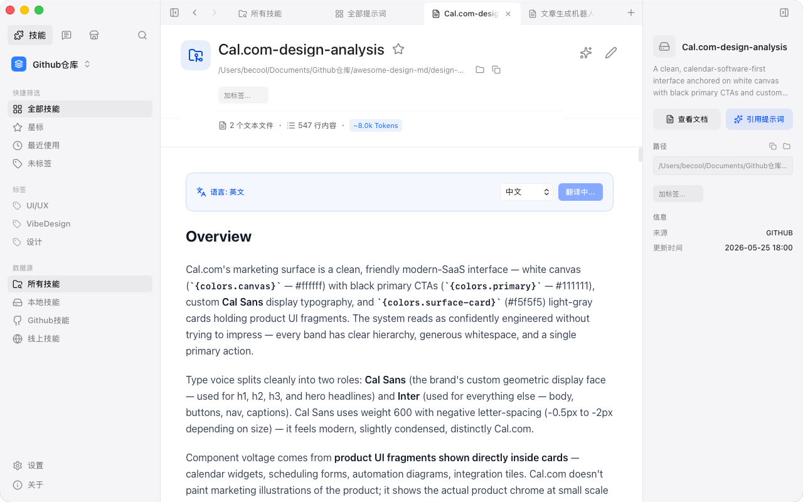</td>
  </tr>
</table>

### 7. 一键同步到 AI Agent

支持将本地技能直接同步到常用 AI Agent 的工作目录（如 Antigravity、Claude Code、Cursor、Codex 等）。通过卡片右键菜单或右侧检查器勾选即可安装或取消同步，已同步的目标会在卡片上标明。

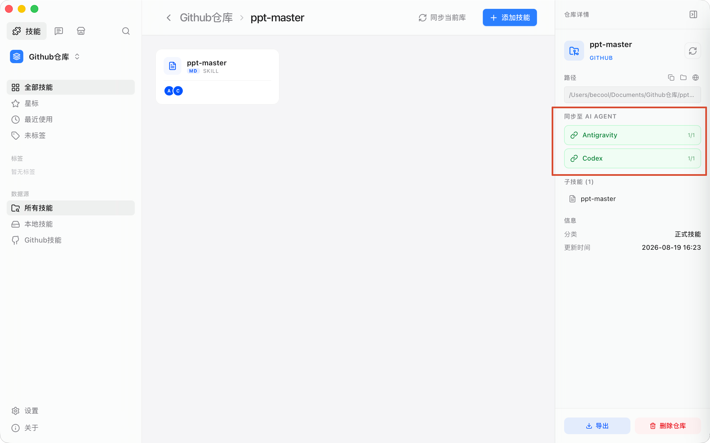

### 8. 生成引用提示词

想让 AI 严格按某套技能规则执行时，选中技能可以直接生成一段带目录结构和执行说明的引用提示词，复制粘贴进对话窗口就能直接用。

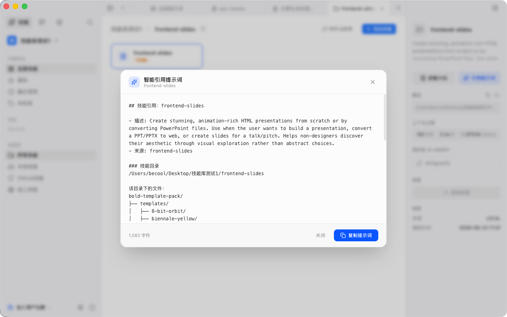

### 9. 多源导入与一键拉取更新

支持关联本地已有文件夹、直接把文件夹拖入窗口导入、克隆 GitHub 仓库，以及收藏线上链接。来自 GitHub 的仓库支持一键检测与拉取上游更新。

<table>
  <tr>
    <td width="50%"></td>
    <td width="50%">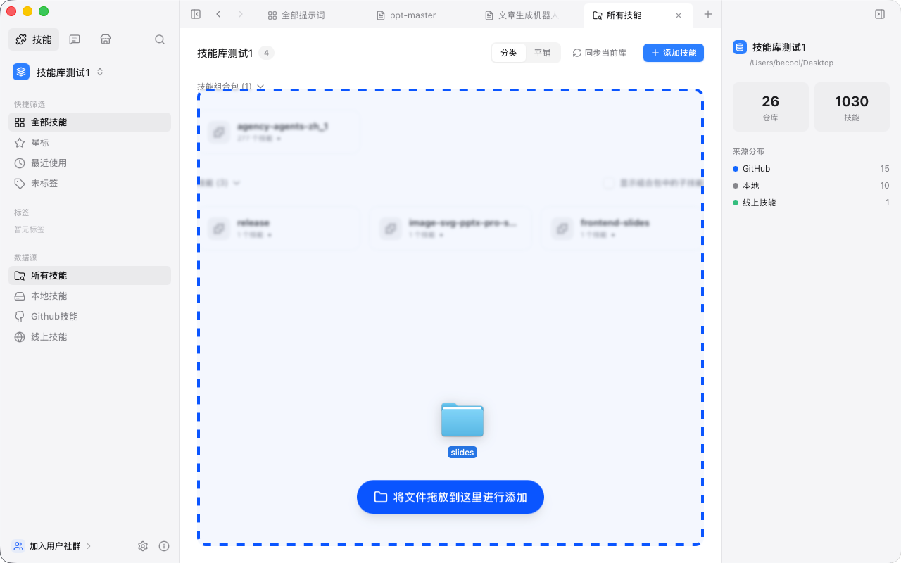</td>
  </tr>
</table>

### 10. 标签、星标与批量操作

支持框选多个卡片批量更新、删除或导出（技能支持导出目录或 ZIP，提示词支持导出 Markdown / JSON / 纯文本）。  
标签与星标采用**两层独立整理**设计：技能包与内部子技能可以各自加星标、打标签而不互相污染；同时内置专属**标签管理面板**，支持常用标签置顶、查看引用数量、重命名、合并以及清理未使用标签。

<table>
  <tr>
    <td width="50%"></td>
    <td width="50%">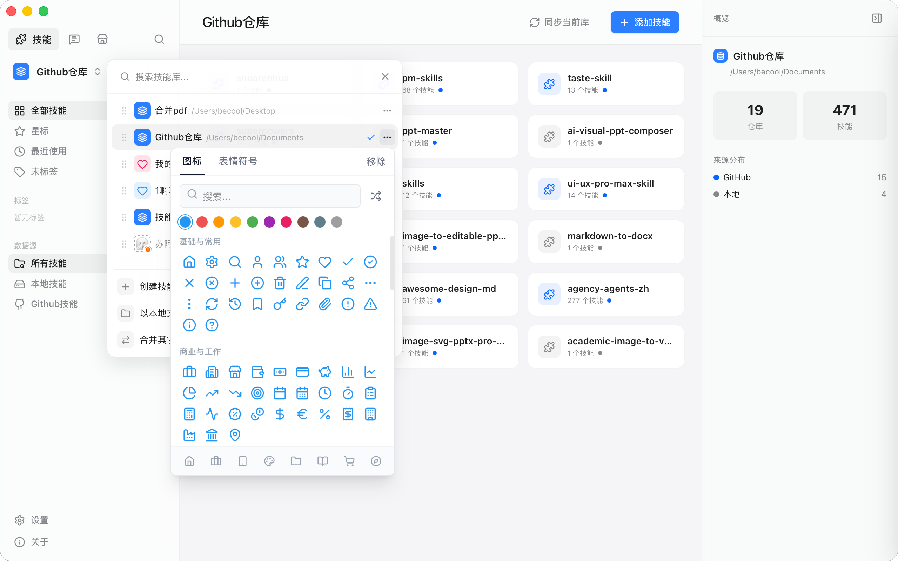</td>
  </tr>
</table>

### 11. 本地存储与备份迁移

所有索引、提示词和偏好配置都存储在本地 SQLite 数据库里。在设置中可以将全部数据打包导出为 ZIP；换电脑或重装系统后一键导入即可恢复，导入前会自动为当前数据留一份本地安全备份。


---

## 主要功能

| 模块 | 功能 | 说明 |
| :--- | :--- | :--- |
| **托盘快捷面板** | 菜单栏 / 系统托盘唤出 | 不打开主窗口也能快速搜技能包、技能与提示词，一键复制引用或正文 |
| **全局搜索** | `Cmd/Ctrl + K` 多域搜索 | 支持搜索本地库、资源社区精选与 GitHub 在线开源仓库 |
| **GitHub Token** | 个人只读 Token 配置 | 填入后将 GitHub 搜索额度提升至 5,000 次/小时，可随时修改或清除 |
| **多源导入** | 本地 / GitHub / 线上链接 | 支持关联本地目录、拖拽导入、克隆 GitHub 仓库及收藏在线地址 |
| **标签体系** | 双层打标与标签管理面板 | 技能包、子技能与提示词独立打标；支持常用星标置顶、重命名合并与计数统计 |
| **星标体系** | 双层独立星标 | 技能包、单技能、子技能和提示词可单独加星标，「星标」视图按层级汇总 |
| **多标签页** | 浏览器式 Tab 工作区 | 可同时打开多个技能库、技能包详情或文档页，支持快捷键和前进后退 |
| **快速预览** | 空格键 QuickLook | 选中卡片按空格即可预览说明与 Markdown 文档，无需跳转详情页 |
| **详情阅读** | 目录大纲与中英翻译 | 自动生成右侧章节目录大纲，英文技能支持中文翻译与原文切换 |
| **Agent 同步** | 分发到 AI 工具目录 | 一键同步/取消同步到 Antigravity、Claude Code、Cursor、Codex 等目录 |
| **提示词管理** | 分组与双视图编辑 | 支持工作流分组、标签补全、排版/纯文本切换及多格式导出（MD/JSON/TXT） |
| **引用生成** | 智能引用提示词 | 自动汇总技能目录与说明生成可直接粘贴使用的引用文本 |
| **批量操作** | 框选与右键菜单 | 框选多个卡片进行批量星标、批量打标、更新、导出目录/ZIP 或删除 |
| **数据备份** | 本地 SQLite 与 ZIP 备份 | 数据完全本地存放，支持全库打包导出并在还原前自动备份当前状态 |

---

## 下载安装

前往 [Releases 页面](https://github.com/VipBeCool/SkillHub/releases/latest) 下载对应系统的安装包：

| 操作系统 | 安装包格式 |
| :--- | :--- |
| **macOS** (Intel & Apple Silicon) | `.dmg`（通用架构） |
| **Windows** (64 位) | `.exe` 安装程序 / `.msi` |
| **Linux** (64 位) | `.AppImage` / `.deb` |

> 应用支持自动检查新版本并应用内更新。

---

## 技术架构

| 分层 | 使用技术 |
| :--- | :--- |
| **前端界面** | React 19, TypeScript, Tailwind CSS v4, Vite |
| **桌面端与存储** | Rust, Tauri v2, SQLite (rusqlite) |
| **构建与发布** | GitHub Actions + tauri-action |

基于 Tauri v2 构建，相比传统 Electron 应用安装包更小，平时常驻托盘与后台占用的内存也更低。

---

## 本地开发

### 前置环境

- [Node.js](https://nodejs.org/) v18 及以上
- [Rust](https://www.rust-lang.org/tools/install) 稳定版
- macOS 需安装 Xcode Command Line Tools (`xcode-select --install`)
- Windows 需安装 Visual Studio C++ Build Tools

### 启动步骤

```bash
# 1. 克隆仓库
git clone https://github.com/VipBeCool/SkillHub.git
cd SkillHub

# 2. 安装前端依赖
npm install

# 3. 启动开发调试
npm run skillhub dev
```

### 构建打包

```bash
npm run skillhub build
```

打包产物位于 `src-tauri/target/release/bundle/` 目录。

---

## 交流群

使用中遇到问题或者有功能建议，欢迎提 Issue，也可以加 QQ 群或关注公众号交流：

<table>
  <tr>
    <th align="center">QQ 交流群（群号：1049282993）</th>
    <th align="center">微信公众号</th>
  </tr>
  <tr>
    <td align="center"></td>
    <td align="center"></td>
  </tr>
</table>

---

## 请我喝咖啡

如果 SkillHub 在日常工作里替你省下了一些时间，欢迎[请作者喝杯咖啡](./docs/DONATE.md)，感谢支持。

---

## 开源协议

本项目基于 [GPL-3.0 协议](./LICENSE) 开源。你可以自由使用、研究和修改代码，衍生修改版本也需遵循相同协议保持开源。如有商业闭源使用需求，请提前联系作者授权。

---

By [VipBeCool](https://github.com/VipBeCool)
