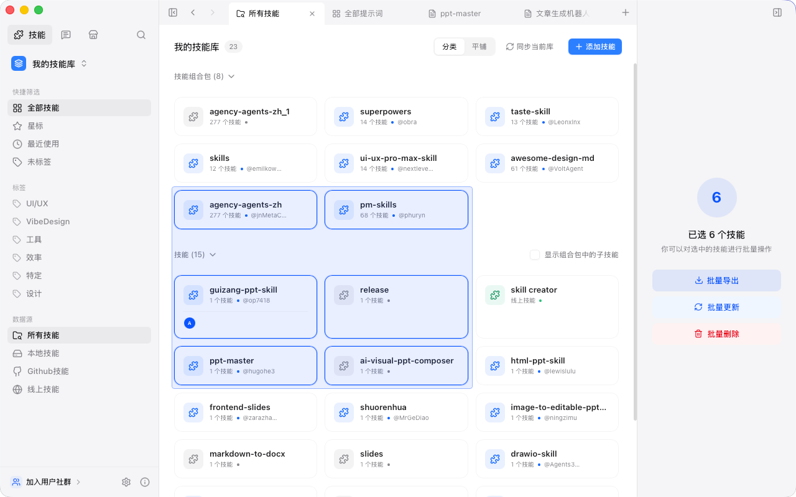
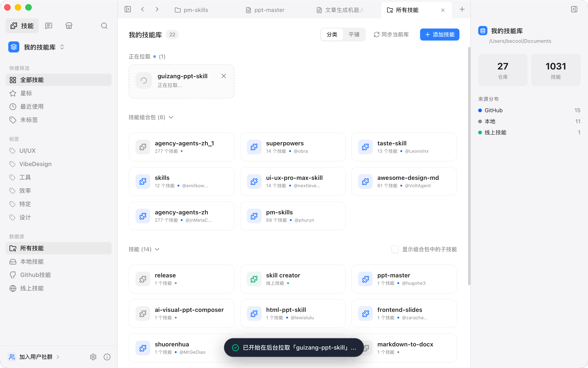
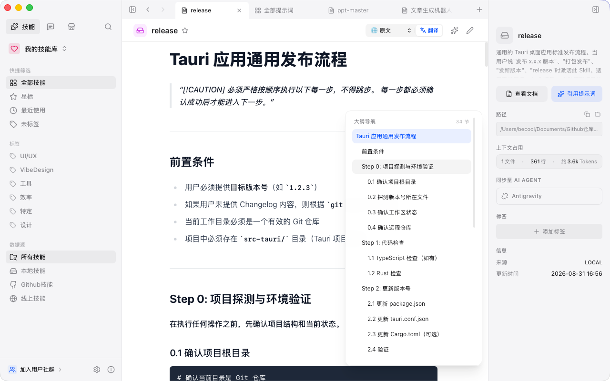
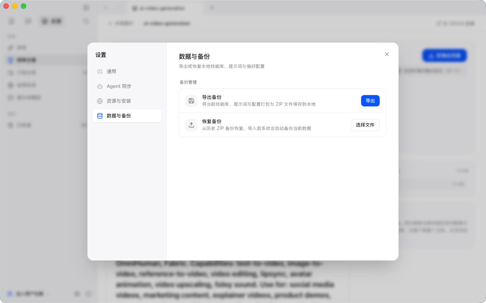

<div align="right">
  <strong>简体中文</strong> | <a href="./README.en.md">English</a>
</div>

<div align="center">
  
  <h1>SkillHub</h1>
  <p><strong>跨平台的 AI Skills 与 Prompts 发现、管理与同步桌面工具</strong></p>
  <p>在一个轻量原生桌面端里，完成全球开源技能与提示词的发现、预览翻译、精准安装、类资源管理器整理，以及一键同步到常用 AI Agent。</p>
  <p>
    
    
    
    
  </p>
</div>

<p align="center">
  <a href="#为什么做-skillhub">为什么做 SkillHub</a> ·
  <a href="#界面与功能">界面与功能</a> ·
  <a href="#主要功能">主要功能</a> ·
  <a href="#下载安装">下载安装</a> ·
  <a href="#本地开发">本地开发</a> ·
  <a href="#交流群">交流群</a> ·
  <a href="#请我喝咖啡">请我喝咖啡</a>
</p>

## 为什么做 SkillHub

平时用 Claude Code、Cursor、Windsurf、Antigravity、Codex 这类 AI 工具写代码、做文档或跑工作流，时间一长，往往会碰到几件绕不开的烦心事：

- **好资源不好找、装起来麻烦**：优质开源 Skill 和 Prompt 分散在 GitHub、榜单站和各类社区里，常常为了用其中的一个子技能，不得不整仓克隆再手动拷贝目录；
- **放得很散、更新跟不上**：有的躺在本地临时目录，有的从 GitHub 克隆下来，还有的记在备忘录或书签里，上游更新了也不知道，手动一个个 `git pull` 很折腾；
- **长文档难读**：不少开源 Skill 是很长的英文 `SKILL.md`，在编辑器里直接看既没有目录大纲，纯英文阅读也很费劲；
- **多工具复用成本高**：想让多个 AI Agent 共用同一批技能和常用提示词，手工拷贝目录或反复切窗口复制都很打断思路。

**SkillHub 把「找资源 → 预览翻译 → 精准安装 → 桌面级整理 → 同步 Agent → 托盘随手用」整条链路收到一个轻量桌面应用里**：数据全部本地优先存储在 SQLite 中，内置国内网络多通道容错，开箱即用。

---

## 界面与功能

> 以下截图均来自 macOS 端，Windows 与 Linux 端交互一致。

### 一、资源发现与一键直装

#### 1. 全新「资源中心」：发现页与技能榜单合集

内置一站式资源发现与安装体验，列表中的所有技能均可在应用内直接预览并一键安装：

- **发现页**：聚合中文场景严选专题卡、每日全球风向 Top 8 以及已订阅仓库入口，打开即逛；
- **每日实时榜**：自动同步全球生态 6 大实时维度（综合精选、本周飙升、累计安装、新星榜、官方严选、社区热议），支持按分类下拉筛选、关键词高亮搜索与只看未安装；
- **精选专题榜**：围绕研发工作流、电商增长、PPT 与办公自动化等真实场景人工整理，附中文能力解读与未装技能一键批量安装，并支持远程清单 24 小时热更新（无需发新版即可同步新专题）。


#### 2. 订阅 Git 仓库、全网目录与安装前 `SKILL.md` 预览

- **自定义订阅仓库**：像软件源一样自由订阅开源或私有 Git 仓库（支持 GitHub / GitLab 多站点只读令牌与增量同步），随时检索并精准提取仓内单个技能；
- **全网技能目录**：支持 `skills.sh` 全球装机量目录检索与 GitHub 开源仓库搜索双引擎切换；
- **安装前实时预览与精准落盘**：点击任意远程技能即可在线预览完整 `SKILL.md`、一键翻译简介并查看配套文件清单；多技能大仓库仅精准提取当前子目录（也可按需安装所属完整技能包），独立单技能仓库自动按标准 Git 仓库拉取，统一纳入「已安装」视图随时检查更新。


#### 3. 多源开源「提示词精选」与本地提示词管理

告别静态内置列表，在资源中心「探索 → 提示词精选」中接入 4 大活跃开源提示词生态，并与本地「提示词」库无缝打通：

- **四大开源频道**：**AiShort 中文精选**（自带中英双语切换与场景解读）、**prompts.chat 全球社区**（3,000+ 条，API 优先且支持国内镜像 CSV 自动兜底）、**Fabric 专业工作流**（266 个工程化系统提示词按需加载）、**LangGPT 结构化模板**；
- **全宽预览与一键入库**：详情页支持双语切换、长文本自动分段中文翻译、阅读/源码双视图、`{{变量}}` 自动识别，一键保存到本地提示词库并实时同步已添加状态；
- **本地精细管理**：支持按工作流分组、自定义排序、独立标签与星标筛选；编辑结构化 Prompt 时可在「排版视图」与「纯文本视图」之间自由切换，保留原始换行与缩进，并支持导出为 Markdown / JSON / 纯文本。


<table>
  <tr>
    <td width="50%"></td>
    <td width="50%"></td>
  </tr>
</table>

---

### 二、类系统资源管理器的桌面级整理与阅读

#### 4. 多标签工作区与分层技能总览

顶部采用类似浏览器的多标签页设计（支持 `Cmd/Ctrl + T` 新建、`Cmd/Ctrl + W` 关闭、前进/后退及启动自动恢复），可以同时打开「技能库」、某个「技能包」内部、「资源中心」或「提示词」页面随时切换。主视图自动区分多技能**技能包**和独立**单技能**，支持分类视图与网格视图切换，也可一键展开查看技能包内的全部子技能。


#### 5. 类资源管理器操作：拖拽、框选、原生右键与批量处理

SkillHub 按原生桌面软件的直觉打磨每一个交互细节，整理技能就像在 macOS 访达或 Windows「此电脑」里操作文件一样顺手：

- **拖拽即导入、拖拽即归类**：直接把本地技能文件夹拖进窗口即可导入；侧边栏多技能库与提示词分组同样支持拖拽排序与归类；
- **拉框多选与批量操作**：在列表空白处按住鼠标拉框即可一次选中多张卡片（支持 `Shift` 连选、`Cmd/Ctrl` 隔行多选），批量星标、批量打标、批量更新、导出文件夹/ZIP 或删除；
- **完整上下文右键菜单**：卡片、技能包与侧边栏均提供原生手感右键菜单，打开、编辑、重命名、打标、同步 Agent、拉取更新、在访达/文件管理器中定位一触即达。

<table>
  <tr>
    <td width="50%"></td>
    <td width="50%"></td>
  </tr>
</table>

#### 6. 双层独立星标、标签管理面板与多库图标

标签与星标采用**两层独立整理**设计：技能包与内部子技能可以各自加星标、打标签而互不干扰；内置专属**标签管理面板**，支持常用标签置顶、查看引用数量、重命名合并与一键清理未使用标签；支持创建/挂载多个本地技能库并自定义文件夹图标。


#### 7. 多源导入、异步拉取进度与上游一键更新

除从资源中心一键直装外，还支持关联本地已有文件夹、克隆任意 GitHub 仓库（自动清洗 `git clone` 前缀与网页路径后缀）以及收藏线上链接。克隆与拉取全程异步在后台执行不阻塞操作，列表实时显示动态进度条，点击进度卡可查看流式终端日志；Git 仓库均支持一键检测并拉取上游最新版本。

<table>
  <tr>
    <td width="50%"></td>
    <td width="50%"></td>
  </tr>
</table>

#### 8. 空格键快速预览（QuickLook）

只想确认某个技能或提示词的具体内容，不必专门进出详情页。在列表选中任意卡片后轻按**空格键**，即可原地弹出磨砂浮层速览 Markdown 正文，再按一次空格或 `Esc` 立即关闭。


#### 9. 文档目录大纲导航与三轨中英翻译对照

面对章节较长的 Skill 文档，详情页右侧自动提取多级标题生成大纲目录，随滚动精准高亮当前章节，点击平滑跳转。阅读纯英文技能时可一键切换中文并支持原文对照；内置「Google → 腾讯交互翻译 → MyMemory」三轨自愈翻译引擎，国内网络环境下同样流畅响应。

<table>
  <tr>
    <td width="50%"></td>
    <td width="50%"></td>
  </tr>
</table>

---

### 三、多 Agent 协同、随手呼出与本地安全

#### 10. 一键同步到 AI Agent 与智能引用提示词

- **系统级软链接（Symlink）实时挂载**：内置 Cursor、Claude Code、Windsurf、Antigravity、Codex 等常用客户端一键预设，通过卡片右键菜单或右侧检查器勾选即可同步/取消同步，技能无需多份拷贝且修改实时生效；
- **生成智能引用提示词**：选中任意技能可直接生成一段包含目录结构与执行说明的引用指令，复制粘贴进 AI 对话框即可让模型严格按规则执行。

<table>
  <tr>
    <td width="50%"></td>
    <td width="50%"></td>
  </tr>
</table>

#### 11. 菜单栏 / 系统托盘快捷面板与 `Cmd/Ctrl + K` 全局搜索

- **随身快捷助手**：写代码或聊天时不想切回主窗口，点击 macOS 顶部菜单栏或 Windows 系统托盘图标即可唤出悬浮面板，自动同步当前技能库，模糊检索技能包、单技能与提示词并一键复制 `@skill-name` 引用或 Prompt 正文，切回编辑器自动收起；
- **全局跨域搜索**：按下 `Cmd/Ctrl + K` 同时检索本地技能库、提示词、专题精选、订阅仓库与 GitHub 开源仓库；在搜索弹窗或设置中填入个人只读 GitHub Token（无需勾选任何权限）即可解锁 5,000 次/小时的搜索额度。


<table>
  <tr>
    <td width="50%"></td>
    <td width="50%"></td>
  </tr>
</table>

#### 12. 本地 SQLite 存储、ZIP 备份迁移与弱网流量控制

- **本地优先与安全备份**：所有索引、提示词与配置全部存储在本地 SQLite 数据库，支持一键打包导出 ZIP；换机或重装后选择备份即可恢复，导入前系统会自动留存一份本地安全快照；
- **弱网稳连与克制后台**：Git 拉取、榜单同步、提示词拉取与应用内更新均支持多通道自动切换（系统代理 → 直连 → 国内镜像回退）；支持开机自启与静默隐藏至托盘，且默认关闭「后台自动同步仓库」以彻底避免后台偷跑代理/VPN 流量。



---

## 主要功能

| 模块 | 功能 | 说明 |
| :--- | :--- | :--- |
| **资源中心** | 发现 / 榜单 / 订阅 / 全网目录 | 6 大每日实时榜、可热更新中文精选专题榜、自定义 Git 仓库订阅、`skills.sh` + GitHub 双检索 |
| **精准安装** | `SKILL.md` 预览与统一更新 | 安装前在线预览与简介翻译；子目录精准提取与独立仓库完整克隆统一管理，支持一键检查更新 |
| **提示词广场** | 4 大开源提示词生态 | 接入 AiShort、prompts.chat、Fabric 与 LangGPT；全宽预览支持双语切换、分段翻译与变量识别入库 |
| **桌面体验** | 类系统资源管理器交互 | 拖拽文件夹导入与归类、拉框多选批量操作、原生上下文右键菜单、空格键 QuickLook 与浏览器式多标签页 |
| **双层整理** | 独立星标与标签管理面板 | 技能包、子技能与提示词独立加星标、打标签；支持常用置顶、引用计数、重命名合并与清理 |
| **多源导入** | 本地 / GitHub / 线上链接 | 关联本地目录、拖拽导入、异步克隆 GitHub 仓库（带实时进度与终端日志）及收藏在线地址 |
| **长文阅读** | 目录大纲与三轨中英翻译 | 自动提取多级标题大纲随滚动高亮；内置三轨容灾翻译引擎，支持中英对照与原文切换 |
| **提示词库** | 工作流分组与双视图编辑 | 支持分组管理、标签联想、排版/纯文本双视图切换及 Markdown / JSON / TXT 多格式导出 |
| **Agent 同步** | Symlink 挂载与智能引用 | 内置主流 AI 客户端预设，软链接实时同步技能目录，支持一键生成带结构的引用提示词 |
| **快捷唤出** | 托盘面板与 `Cmd/Ctrl + K` | 菜单栏/托盘随时检索复制；全局搜索覆盖本地库、专题榜、订阅仓与 GitHub（支持只读 PAT 提额） |
| **本地与安全** | SQLite、ZIP 备份与流量控制 | 全本地化存储与恢复前自动快照；多通道镜像容错、开机静默自启，默认关闭后台同步省流量 |

---

## 下载安装

前往 [Releases 页面](https://github.com/VipBeCool/SkillHub/releases/latest) 下载对应系统的安装包：

| 操作系统 | 安装包格式 |
| :--- | :--- |
| **macOS** (Intel & Apple Silicon) | `.dmg`（通用架构） |
| **Windows** (64 位) | `.exe` 安装程序 / `.msi` |
| **Linux** (64 位) | `.AppImage` / `.deb` |

> 应用支持自动检测新版本、折叠/大窗浏览结构化更新日志并一键完成应用内更新。

---

## 技术架构

| 分层 | 使用技术 |
| :--- | :--- |
| **前端界面** | React 19, TypeScript, Tailwind CSS v4, Vite |
| **桌面端与存储** | Rust, Tauri v2, SQLite (`rusqlite`) |
| **构建与发布** | GitHub Actions + `tauri-action` |

基于 Tauri v2 与系统原生 WebView 构建，相比传统 Electron 应用安装包更小，平时常驻托盘与后台占用的内存也更低。

---

## 本地开发

### 前置环境

- [Node.js](https://nodejs.org/) v18 及以上
- [Rust](https://www.rust-lang.org/tools/install) 稳定版
- macOS 需安装 Xcode Command Line Tools (`xcode-select --install`)
- Windows 需安装 Visual Studio C++ Build Tools

### 启动步骤

```bash
# 1. 克隆仓库
git clone https://github.com/VipBeCool/SkillHub.git
cd SkillHub

# 2. 安装前端依赖
npm install

# 3. 启动开发调试
npm run skillhub dev
```

### 构建打包

```bash
npm run skillhub build
```

打包产物位于 `src-tauri/target/release/bundle/` 目录。

---

## 开源生态致谢

SkillHub 的资源中心与提示词广场接入了以下优秀开源项目与开放数据，特此致谢：

- [Linkly AI · Best Skills](https://github.com/LinklyAI/best-skills)（CC BY 4.0）—— 每日实时技能风向榜数据
- [skills.sh](https://skills.sh) —— 全球公开 Agent Skills 目录与安装量检索
- [AiShort (ChatGPT-Shortcut)](https://github.com/rockbenben/ChatGPT-Shortcut)（MIT）—— 中文双语精选提示词数据
- [prompts.chat](https://prompts.chat)（CC0）—— 全球开源提示词社区与开放数据集
- [Fabric](https://github.com/danielmiessler/fabric)（MIT）—— 专业工程化系统提示词工作流
- [LangGPT](https://github.com/langgptai/LangGPT)（Apache-2.0）—— 中文结构化提示词模板体系

---

## 交流群

使用中遇到问题或者有功能建议，欢迎提 Issue，也可以加 QQ 群或关注公众号交流：

<table>
  <tr>
    <th align="center">QQ 交流群（群号：1049282993）</th>
    <th align="center">微信公众号</th>
  </tr>
  <tr>
    <td align="center"></td>
    <td align="center"></td>
  </tr>
</table>

---

## 请我喝咖啡

如果 SkillHub 在日常工作里替你省下了一些时间，欢迎[请作者喝杯咖啡](./docs/DONATE.md)，感谢支持。

---

## 开源协议

本项目基于 [GPL-3.0 协议](./LICENSE) 开源。你可以自由使用、研究和修改代码，衍生修改版本也需遵循相同协议保持开源。如有商业闭源使用需求，请提前联系作者授权。

---

By [VipBeCool](https://github.com/VipBeCool)
